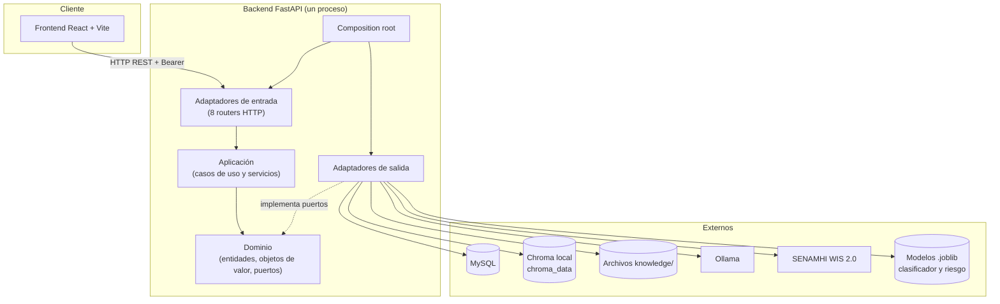
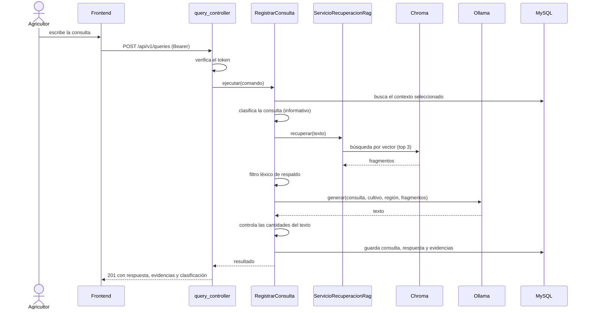

# Arquitectura real encontrada (Fase 5, Prompt 9)

## Alcance y método

- **Fuentes:** código fuente (`backend/app`, `frontend/src`), `composition.py`, dependencias, configuración, logs de ejecución, `render.yaml` y `docs/ARQUITECTURA.md` (solo para contrastar).
- **Commit base del código:** `eaac3da`.
- **Regla:** solo se registra lo evidenciado. Lo que no se ejecutó se describe desde el código y se rotula así.

## 1. Arquitectura general

Monolito modular con arquitectura hexagonal (puertos y adaptadores), formado por:

- Un **backend** en Python con FastAPI, en un solo proceso.
- Un **frontend** de página única en React, servido por Vite.
- Una **base de datos** MySQL.
- Un **almacén vectorial** Chroma, embebido en el proceso del backend.
- Un **servidor de modelo de lenguaje** (Ollama), externo al proceso.
- Una **API pública externa** (SENAMHI WIS 2.0).

### Detección de patrones

| Patrón | Evidencia | Confianza |
|---|---|---|
| Arquitectura hexagonal | Carpetas `domain/ports/input`, `domain/ports/output`, `application/useCases`, `infrastructure/adapters/{input,output}`; puertos como clases abstractas; composición en `composition.py`; `/health` responde `architecture: hexagonal`; `test_architecture.py` | Alta |
| Arquitectura por capas | Tres capas con dependencia unidireccional: infraestructura → aplicación → dominio; sin violaciones en el análisis de imports | Alta |
| Monolito modular | Un solo despliegue de backend con módulos por función (autenticación, contextos, consulta, conocimiento, clasificación, riesgo, clima) | Alta |
| Clean Architecture | Comparte la regla de dependencia, pero no define capas separadas de casos de uso y presentadores | Media |
| MVC | No hay vistas del lado del servidor; el frontend es una aplicación separada | Baja |
| Microservicios | Un solo servicio de backend y un frontend estático | No evidenciado |
| Orientada a eventos | Sin colas, bus de eventos ni suscriptores; todo es síncrono | No evidenciado |

**Arquitectura predominante:** hexagonal sobre un monolito modular.

## 2. Componentes

| Componente | Tecnología | Función | Evidencia |
|---|---|---|---|
| Frontend | React 18, React Router 6, Axios, Vite 5.4.11 | Interfaz web: acceso, contexto, consulta, conocimiento y riesgo | `frontend/package.json`, `App.jsx` |
| Adaptadores de entrada | FastAPI | 8 routers HTTP y la dependencia de autenticación | `main.py`, `adapters/input/http` |
| Aplicación | Python | 12 casos de uso y 4 módulos de servicio | `application/useCases`, `application/services` |
| Dominio | Python | 7 entidades, 6 objetos de valor, puertos, excepciones | `domain` |
| Persistencia relacional | SQLAlchemy y PyMySQL sobre MySQL | 5 repositorios | `adapters/output/mysql`, `database/schema.sql` |
| Almacén vectorial | Chroma (cliente persistente local, similitud coseno) | Fragmentos y búsqueda por vector | `chroma_vector_store_adapter.py` |
| Embeddings | Hash de tokens de 128 dimensiones (local); adaptador externo sin proveedor concreto | Vectores para la recuperación | `local_lexical_embedding_adapter.py`, `external_embedding_adapter.py` |
| Generación de texto | Ollama por HTTP (modelo `qwen2.5:1.5b` por defecto); adaptador de plantilla para pruebas | Redacción de la respuesta | `adaptador_generacion_ollama.py`, `adaptador_generacion_plantilla.py` |
| Clasificador | TF-IDF y regresión logística (`.joblib`) | Categoría temática de la consulta | `adaptador_clasificador_tfidf.py` |
| Predictor de riesgo | Pipeline de scikit-learn (`.joblib`) | Categoría de riesgo experimental | `adaptador_predictor_riesgo.py` |
| Seguridad | bcrypt y PyJWT | Hash de contraseñas y tokens | `adapters/output/security` |
| Clima | httpx hacia SENAMHI WIS 2.0 | Observaciones meteorológicas | `adaptador_senamhi_wis2.py` |
| Composición | `CompositionRoot` | Crea y conecta todos los adaptadores | `composition.py` |

## 3. Relaciones y dependencias

**Regla de dependencia verificada:** el dominio y la aplicación solo importan la biblioteca estándar. Los controladores reciben el contenedor completo (`create_*_router(container)`) y acceden a sus atributos `puerto_*`; es un patrón de localizador de servicios, no una inyección individual de puertos.

## 4. Integraciones

| Integración | Dirección | Protocolo | Obligatoria para arrancar | Evidencia |
|---|---|---|---|---|
| MySQL | Backend → base | PyMySQL, `connect_timeout` de 3 s | No: el arranque funciona sin base (`/health` responde `mysql: disconnected`) | `connection.py`; `backend_logs.txt` |
| Ollama | Backend → servidor | HTTP, timeout de 90 s | No: la generación falla con 503 al consultar | `adaptador_generacion_ollama.py`; `settings.py` |
| SENAMHI WIS 2.0 | Backend → API pública | HTTP GET, timeout de 20 s | No | `adaptador_senamhi_wis2.py` |
| Chroma | Backend → disco local | Cliente persistente embebido | Sí: se crea al construir el contenedor | `composition.py` |
| Archivos de conocimiento | Backend → disco | Lectura y escritura de `.md` y `.json` | No | `repositorio_documento_conocimiento.py` |
| Modelos `.joblib` | Backend → disco | Carga diferida con candado | La ruta se resuelve al arrancar; el modelo se carga en el primer uso | `adaptador_clasificador_tfidf.py`, `adaptador_predictor_riesgo.py` |
| Frontend → backend | Navegador → API | Axios; proxy de Vite para `/health` y `/api` en local | — | `client.js`, `vite.config.js` |
| OpenAI y RAGAS (opcional) | Solo en `backend/evaluation` | HTTP | No forma parte del flujo de la aplicación | `ragas_runner.py` |

## 5. Flujo de datos de una consulta

Este flujo se reconstruyó desde el código. No se ejecutó de punta a punta porque no hubo base de datos ni Ollama.

## 6. Flujo de datos de la base de conocimiento

1. El agricultor envía título, tema y contenido a `/knowledge/ingest`.
2. El backend calcula el SHA-256, rechaza duplicados, escribe `knowledge/<id>.md` y `<id>.meta.json`, y registra ruta y hash en MySQL.
3. `/knowledge/index` lee cada archivo, lo fragmenta, calcula los vectores y los inserta en Chroma con los metadatos (documento, título, tema, hash, índice y ruta).
4. Las consultas posteriores buscan en Chroma; las evidencias guardadas apuntan al documento por id.

## 7. Despliegue

- **Local:** backend con `uvicorn` en el puerto 8000, frontend con Vite en el 5173 y proxy para `/health` y `/api`.
- **Propuesto (`render.yaml`):** servicio web de Python en plan gratuito y sitio estático para el frontend. El archivo declara que no crea MySQL, no monta disco y no publica Ollama.
- **No evidenciado:** Dockerfile, docker-compose, integración continua.

## 8. Documentado frente a real

| Tema | Documentación | Código | Estado |
|---|---|---|---|
| Capas y reglas de dependencia | `docs/ARQUITECTURA.md`, secciones «Capas» y «Reglas» | Coinciden con el análisis de imports y con `test_architecture.py` | Coincide |
| Historias HU-01 a HU-06 | README y ARQUITECTURA | Implementadas | Coincide |
| Clasificación (HU-07), riesgo (HU-08) y clima | Sin mención en README, ARQUITECTURA ni INSTALACION | 3 endpoints, 3 casos de uso y 3 adaptadores | Documentado ≠ real |
| Nombres de tablas | ARQUITECTURA usa nombres en inglés (según `servicios.md`) | `schema.sql` usa nombres en español | Documentado ≠ real |
| Módulos del código | — | 42 módulos duplicados sin uso | Código sobrante |

## 9. Limitaciones del análisis

- Los flujos que dependen de MySQL y Ollama se reconstruyeron desde el código.
- No se leyeron en detalle `FragmentadorDocumentos`, `referencia_origen` ni los scripts de `backend/evaluation`.
- Los modelos `.joblib` y los datasets de entrenamiento no formaron parte del análisis.
