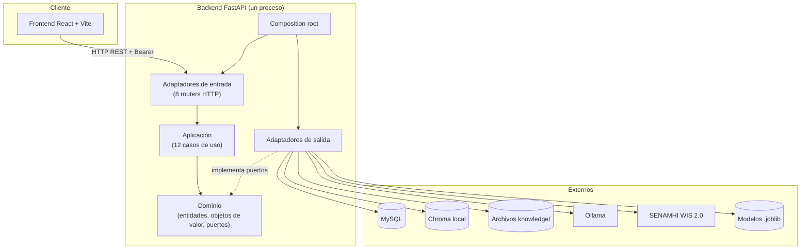
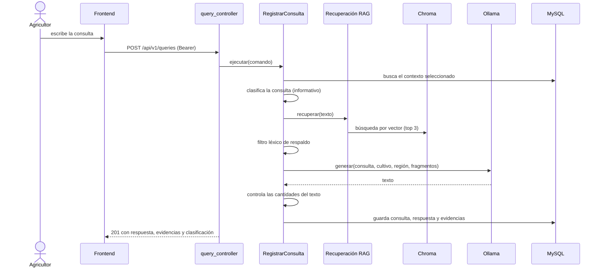
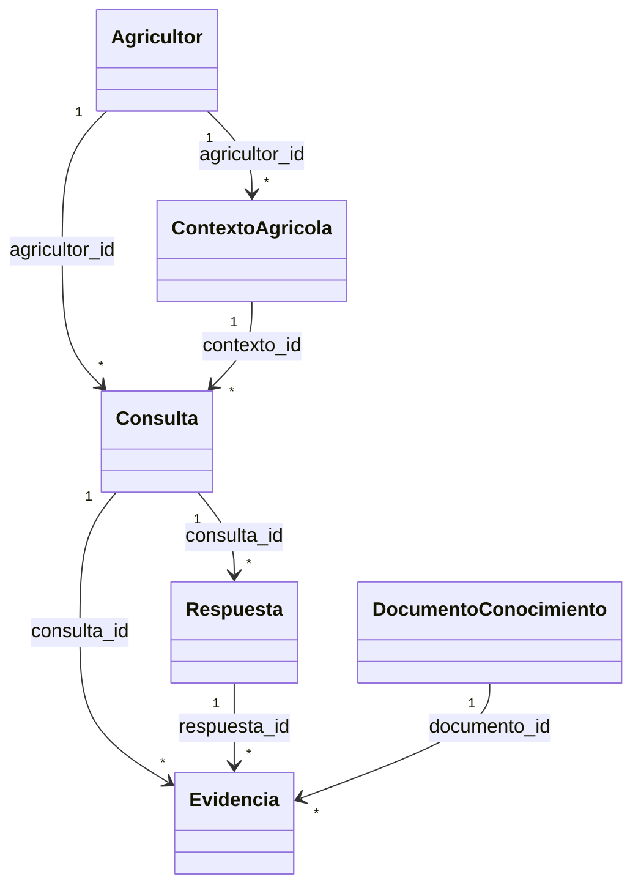

# Reporte de Ingeniería Inversa

**Proyecto:** Agro-Asistente (curso Taller de Proyectos 1, PMV1)
**Repositorio:** `Kai-Sid/agro-asistente`
**Commit base del código analizado:** `eaac3da` (rama `main`)
**Rama de las evidencias:** `miguel05angel/ingenieria-inversa`
**Autor del análisis:** Miguel Angel Izquierdo Quintana
**Fecha:** 22 de noviembre de 2026

> **Convención del informe.** Solo se afirma lo que consta en el código, en la configuración, en los logs de ejecución o en la salida de las pruebas. Lo que no se pudo verificar figura como **«No evidenciado»**. Cada evidencia indica su método: *(ejecución)*, *(código)*, *(estático)* o *(pruebas)*.

---

## 1. Resumen Ejecutivo

Agro-Asistente es un sistema web de asistencia técnica para agricultores familiares. El agricultor se registra, define un contexto agrícola (cultivo y región) y hace consultas en lenguaje natural. El backend recupera fragmentos de una base de conocimiento (RAG) y un modelo de lenguaje local (Ollama) redacta la respuesta con evidencias. Además incluye un clasificador de consultas, un predictor de riesgo experimental y un consumo de observaciones meteorológicas de SENAMHI.

**Cifras principales**

| Dato | Valor |
|---|---|
| Backend (aplicación) | 149 archivos Python, 7 213 líneas |
| Frontend | 26 archivos JavaScript y JSX, 1 951 líneas |
| Endpoints de la API | 13 (4 públicos y 9 con sesión) |
| Casos de uso | 12 |
| Entidades de dominio | 7, más 6 objetos de valor |
| Pruebas | 33 archivos de prueba en el backend y 4 en el frontend |
| Hallazgos | 26: 1 crítico, 5 altos, 13 medios y 7 bajos |
| Calidad arquitectónica (promedio) | 3.2 de 5 |

**Conclusiones principales**

1. **La arquitectura es hexagonal y está bien aplicada.** Dominio y aplicación importan solo la biblioteca estándar, no hay violaciones de capa, y una prueba automática vigila las reglas *(estático, pruebas)*.
2. **Hay credenciales reales de base de datos en un script que se subió a GitHub (H-01)**, y el secreto JWT tiene un valor por defecto sin ninguna protección (H-02).
3. **El 26 % del código de la aplicación son módulos duplicados sin uso (H-07):** 42 módulos en inglés que nadie importa.
4. **El backend arranca sin base de datos**, pero login y registro responden 500 sin controlar el error (H-03).
5. **La persistencia del conocimiento depende del disco local** (archivos y Chroma), y el despliegue propuesto no monta disco (H-05).

**Estado de la ejecución.** Backend y frontend se levantaron en Windows. Los flujos que necesitan MySQL u Ollama no se pudieron ejecutar de punta a punta y se analizaron desde el código.

---

## 2. Objetivos

**Objetivo general.** Reconstruir, a partir del código y de su ejecución, cómo está construido realmente Agro-Asistente, y evaluar su calidad con evidencia trazable.

**Objetivos específicos**

1. Identificar las tecnologías, dependencias y servicios del proyecto sin suponer ningún lenguaje o framework previo.
2. Reconstruir el entorno necesario para ejecutarlo y documentar la configuración.
3. Ejecutar el sistema, registrar sus logs y detectar los endpoints y flujos reales.
4. Reconstruir la arquitectura, los módulos, el modelo de dominio y los casos de uso.
5. Evaluar la calidad (cohesión, acoplamiento, escalabilidad, mantenibilidad, testabilidad y seguridad) y consolidar una matriz de hallazgos con recomendaciones.

---

## 3. Alcance

**Incluye**

- Backend (`backend/app`, `backend/tests`), frontend (`frontend/src`), `database/schema.sql`, `render.yaml`, `README.md` y `docs/`.
- Ejecución local en Windows: instalación, arranque del backend y del frontend, y pruebas de endpoints.
- Análisis estático de imports y ejecución de las pruebas en un entorno aparte.

**No incluye**

- Contenido de los datasets y del entrenamiento (`auditoria_*`, `piloto_hu07_v2`, `cierre_observaciones_entrenamiento_hu07`, `backend/clasificacion` más allá de su estructura).
- El modelo de MySQL Workbench (`database/agro.mwb`, archivo binario).
- Ejecución con base de datos, con Ollama y con el despliegue real en Render.
- Medición de rendimiento, de cobertura de pruebas y análisis de seguridad dinámico.

---

## 4. Metodología

Se siguió un plan de 12 prompts en 7 fases. Cada fase produjo archivos de evidencia en `evidencias/`.

### 4.1 Auditoría

- Inventario de archivos versionados con `git ls-files` y detección de tecnologías y de arquitectura a partir de la estructura de carpetas.
- Evidencia: `evidencias/auditoria/inventario_archivos.md`, `stack_tecnologico.md`, `arquitectura_detectada.md`.

### 4.2 Instalación

- Entorno: Windows, Python 3.13.17, Node v26.13.1.
- Backend: entorno virtual `backend/venv` e instalación de `requirements.txt`. La instalación terminó con éxito *(ejecución: `pip_install_log.txt:556`)*.
- Frontend: `npm ci` terminó sin errores y reportó 6 vulnerabilidades *(ejecución: `npm_install_log.txt:7`)*.
- Evidencia: `evidencias/dependencias/` y `evidencias/configuracion/instalacion.md`.

### 4.3 Configuración

- Análisis de `.env.example`, `settings.py`, `render.yaml` y del uso de variables en el código.
- Se creó un `.env` local a partir del ejemplo con un `JWT_SECRET` generado al azar. No se configuró conexión a base de datos.
- Evidencia: `evidencias/configuracion/variables_entorno.md` y `servicios.md`.

### 4.4 Ejecución

- Backend con `uvicorn` en `127.0.0.1:8000` y frontend con Vite en `127.0.0.1:5173`, con los logs guardados en archivo.
- Se probaron `/health`, los endpoints de lectura y el login y registro con datos ficticios.
- Evidencia: `evidencias/ejecucion/` (logs, `openapi.json`, `backend_logs.md`, `frontend_logs.md`, `endpoints_detectados.md`).

### 4.5 Ingeniería inversa

- Análisis estático de imports con AST sobre `backend/app` (capas, dependencias y código no alcanzable).
- Lectura del dominio, los casos de uso, los controladores, los repositorios, los adaptadores, el frontend y el esquema SQL.
- Suite de pruebas del backend en un entorno aparte (Linux, Python 3.12.3): 225 pruebas recolectadas; 184 pasaron, 39 fallaron y 2 se omitieron. De los fallos, 27 fueron por conexión rechazada a MySQL y los otros 12 por archivos de datos o modelos ausentes del paquete analizado, o por `ragas` no instalado en ese entorno.
- Pruebas del frontend con `node --test`: 3 archivos, 18 pruebas, todas pasaron.
- Evidencia: `evidencias/analisis/` (`modulos.md`, `dominio.md`, `casos_uso.md`, `arquitectura_real.md`, `calidad_arquitectura.md`, `hallazgos.md`).

---

## 5. Inventario Tecnológico

| Categoría | Tecnología | Evidencia | Confianza |
|---|---|---|---|
| Lenguajes | Python | `backend/app`, `requirements.txt` | Alta |
| Lenguajes | JavaScript y JSX | `frontend/src`, `package.json` | Alta |
| Lenguajes | SQL (MySQL) | `database/schema.sql` | Alta |
| Backend | FastAPI 0.165.0 y Uvicorn 0.54.0 | `main.py`; `pip_install_log.txt:556` | Alta |
| Backend | Pydantic 2.14.4 y pydantic-settings 2.16.3 | `settings.py`; `pip_install_log.txt:556` | Alta |
| Persistencia | SQLAlchemy 2.1.9 y PyMySQL 1.2.4 sobre MySQL | `adapters/output/mysql`; `schema.sql` | Alta |
| Vectores | ChromaDB 1.5.9 (cliente persistente local) | `chroma_vector_store_adapter.py` | Alta |
| Modelo de lenguaje | Ollama por HTTP, modelo `qwen2.5:1.5b` por defecto | `adaptador_generacion_ollama.py`; `.env.example` | Alta |
| Machine learning | scikit-learn 1.9.1 y joblib 1.6.0 (TF-IDF y regresión logística) | `adaptador_clasificador_tfidf.py` | Alta |
| Seguridad | bcrypt 5.0.0 y PyJWT 2.15.1 | `adapters/output/security` | Alta |
| Cliente HTTP | httpx 0.28.1 | `adaptador_senamhi_wis2.py`, `adaptador_generacion_ollama.py` | Alta |
| Evaluación | RAGAS 0.4.3 (fuera de la aplicación) | `requirements.txt`; `backend/evaluation` | Alta |
| Pruebas | pytest 9.2.0 y `node:test` | `backend/tests`; `*.test.js` | Alta |
| Frontend | React ^18.3.1, React Router ^6.30.1 y Axios ^1.8.4 | `frontend/package.json` | Alta |
| Frontend | Vite 5.4.11 | `package.json`; `frontend_logs.txt:6` | Alta |
| Despliegue | Render (propuesta en `render.yaml`) | `render.yaml` | Alta |
| Servicios externos | SENAMHI WIS 2.0 | `adaptador_senamhi_wis2.py` | Alta |
| Base de datos | MySQL; TiDB Cloud en el `.env` local del equipo | `schema.sql`; `evidencias/configuracion/servicios.md` | Media |
| Autenticación | JWT con `HS256`, 120 minutos por defecto | `settings.py`; `emisor_token_jwt.py` | Alta |
| DevOps | Dockerfile, docker-compose, CI | No evidenciado | — |

**Conclusión técnica.** Aplicación web de dos capas visibles (frontend de página única y API REST) con un backend en Python estructurado como monolito modular hexagonal. El modelo de lenguaje y los vectores se ejecutan localmente, sin servicios de inteligencia artificial de terceros en el flujo de la aplicación.

---

## 6. Arquitectura Detectada

| Patrón | Evidencia | Confianza |
|---|---|---|
| Arquitectura hexagonal | `domain/ports/input`, `domain/ports/output`, `application/useCases`, `infrastructure/adapters`; `composition.py`; `/health` responde `architecture: hexagonal`; `test_architecture.py` | Alta |
| Arquitectura por capas | Dependencia unidireccional infraestructura → aplicación → dominio, sin violaciones *(estático)* | Alta |
| Monolito modular | Un solo despliegue de backend con módulos por función | Alta |
| Clean Architecture | Comparte la regla de dependencia, sin capa separada de presentadores | Media |
| MVC | Sin vistas del lado del servidor | Baja |
| Microservicios | Un solo servicio de backend | No evidenciado |
| Orientada a eventos | Sin colas ni bus de eventos | No evidenciado |

**Arquitectura predominante:** hexagonal sobre monolito modular.

**Tamaño por capa** *(estático)*

| Capa | Archivos | Líneas | Imports externos |
|---|---|---|---|
| `domain` | 65 | 2 073 | Solo biblioteca estándar |
| `application` | 30 | 1 714 | Solo biblioteca estándar |
| `infrastructure` | 52 | 3 361 | FastAPI, SQLAlchemy, Chroma, httpx, jwt, bcrypt, joblib, numpy |

**Código no alcanzable.** 42 módulos (1 904 líneas, 26 %) no los importa `app.main` ni ninguna prueba. Son duplicados en inglés de módulos activos en español *(estático)*.

---

## 7. Dependencias

**Backend (`requirements.txt`).** `fastapi`, `uvicorn`, `pydantic`, `pydantic-settings`, `sqlalchemy`, `pymysql`, `chromadb`, `bcrypt`, `pyjwt`, `httpx`, `python-dotenv`, `pytest`, `ragas==0.4.3`, `scikit-learn` y `joblib`.

**Frontend (`package.json`).** Producción: `axios`, `react`, `react-dom`, `react-router-dom`. Desarrollo: `@vitejs/plugin-react` 4.3.4 y `vite` 5.4.11.

| Clasificación | Dependencias |
|---|---|
| Críticas | `fastapi`, `sqlalchemy`, `pymysql`, `chromadb`, `pyjwt`, `bcrypt`, `react`, `react-router-dom` |
| Seguridad | `pyjwt`, `bcrypt` |
| Persistencia | `sqlalchemy`, `pymysql`, `chromadb` |
| APIs | `fastapi`, `uvicorn`, `httpx`, `axios` |
| Fuera del flujo de la aplicación | `ragas` y las bibliotecas que instala; `pytest` |

**Observaciones**

- Todas las dependencias del backend usan rangos `>=`, salvo `ragas`, que está fijo. No hay archivo de bloqueo (H-14).
- `pytest` y `ragas` están en el mismo archivo que las dependencias de producción, y el build de Render instala ese archivo completo (H-14).
- El log de pip incluye `langchain*`, `datasets` y `openai`; probablemente las instala `ragas` (No verificado).
- `npm audit` reporta 6 vulnerabilidades: 3 moderadas y 3 altas, entre ellas `esbuild` hasta la versión 0.24.2 y dos avisos de React Router (H-06) *(ejecución)*.
- Solo se encontró un `package.json` (frontend); existen `package-lock.json` en la raíz, en `backend` y en `frontend`.
- Los modelos `.joblib` dependen de la versión de scikit-learn instalada (H-14).

---

## 8. Configuración

Las variables se leen con `pydantic-settings` desde el entorno y desde el archivo `.env` (que Git ignora). Detalle completo: `evidencias/configuracion/variables_entorno.md`.

| Grupo | Variables |
|---|---|
| Servidor | `APP_NAME`, `APP_ENV`, `API_HOST`, `API_PORT`, `PORT` |
| Base de datos | `MYSQL_HOST`, `MYSQL_PORT`, `MYSQL_USER`, `MYSQL_PASSWORD`, `MYSQL_DATABASE` |
| Seguridad | `JWT_SECRET`, `JWT_ALGORITHM`, `JWT_EXPIRE_MINUTES`, `CORS_ORIGINS` |
| RAG | `KNOWLEDGE_DIR`, `CHROMA_PERSIST_DIR`, `CHROMA_COLLECTION`, `RAG_TOP_K`, `RAG_MIN_SIMILARITY`, `CHUNK_SIZE` |
| Embeddings | `EMBEDDING_PROVIDER`, `EMBEDDING_DIMENSION`, `EMBEDDING_API_URL`, `EMBEDDING_API_KEY`, `EMBEDDING_MODEL` |
| Generación | `GENERATION_PROVIDER`, `OLLAMA_BASE_URL`, `OLLAMA_MODEL`, `OLLAMA_TIMEOUT_SECONDS` |
| Clima | `SENAMHI_WIS2_BASE_URL`, `SENAMHI_WIS2_COLLECTION`, `SENAMHI_WIS2_TIMEOUT_SECONDS` |
| Clasificador | `CLASIFICADOR_MARGEN_MINIMO`, `CLASIFICADOR_MODELO_RUTA` |
| Evaluación | `RAGAS_LLM_PROVIDER`, `RAGAS_EMBEDDING_MODEL`, `OPENAI_API_KEY` |

**Valores por defecto relevantes:** `API_HOST=127.0.0.1`, `API_PORT=8000`, JWT `HS256` y 120 minutos, `RAG_TOP_K=3`, `RAG_MIN_SIMILARITY=0.12`, `CHUNK_SIZE=500`, embeddings locales de 128 dimensiones, modelo `qwen2.5:1.5b`, margen del clasificador 0.17.

**Secretos y datos sensibles:** `JWT_SECRET`, `MYSQL_PASSWORD`, `EMBEDDING_API_KEY` y `OPENAI_API_KEY`.

**Riesgos de configuración**

- `JWT_SECRET` tiene un valor por defecto fijo, y `APP_ENV` no se usa para impedirlo (H-02).
- El arranque resuelve rutas de modelos en `backend/clasificacion/experimentos` (H-15).
- El `render.yaml` es una propuesta: sin MySQL, sin disco y sin Ollama (H-17).

---

## 9. Ejecución

| Elemento | Resultado | Evidencia |
|---|---|---|
| Primer arranque del backend | Falló: Windows bloqueó la extensión compilada `_processors_cy` de SQLAlchemy (Control de aplicaciones) | `backend_logs_intento1_bloqueo.txt:1`, `:83` |
| Solución aplicada | Se renombraron a mano los 8 archivos `.pyd` de SQLAlchemy, que pasó a modo Python puro | Acción del auditor |
| Segundo arranque | Correcto: `Application startup complete` en `127.0.0.1:8000` | `backend_logs.txt:2-4` |
| `GET /health` | 200 con `mysql: disconnected` | `backend_logs.txt:5` |
| `GET /api/v1/contexts` y `/knowledge/documents` sin sesión | 401 | `backend_logs.txt:8-9` |
| `GET /api/v1/weather/observations` sin sesión | 200 | `backend_logs.txt:10` |
| `POST /api/v1/auth/login` (3 intentos) | 500 por `OperationalError 2003` (MySQL en `localhost` sin servidor) | `backend_logs.txt:13-14`, `:251`, `:253` |
| `POST /api/v1/auth/register` (1 intento) | 500, misma causa | Salida de consola |
| Frontend | Vite 5.4.11 listo en 974 ms; `http://127.0.0.1:5173` respondió 200 | `frontend_logs.txt:6` |
| Pantalla de login | Muestra «No se pudo iniciar sesión. Inténtalo de nuevo.» ante el 500 | Captura `03_login_error.png` |

**Análisis de logs:** `backend_logs.md` registra 12 hallazgos (5 altos, 3 medios y 4 bajos) y `frontend_logs.md` registra 6 (2 altos, 1 medio y 3 bajos).

**Limitación:** sin base de datos ni Ollama no se ejecutó ningún flujo de usuario con sesión.

---

## 10. Reconstrucción Arquitectónica

**Componentes.** Ocho adaptadores de entrada (salud, autenticación, contextos, consulta, conocimiento, clima, clasificación y riesgo), 12 casos de uso, cinco repositorios MySQL, adaptadores de vectores, embeddings, generación de texto, clasificación, riesgo, seguridad y clima, y un `CompositionRoot` que los conecta.

**Relaciones.** Los controladores reciben el contenedor completo y acceden a sus atributos `puerto_*` (localizador de servicios). Los casos de uso dependen solo de puertos.

**Flujo de datos de una consulta** *(reconstruido desde el código; no ejecutado)*

**Documentado frente a real.** La documentación (`README.md`, `ARQUITECTURA.md`, `INSTALACION.md`) coincide con el código en capas y en las historias HU-01 a HU-06, pero no menciona clasificación (HU-07), riesgo (HU-08) ni clima, que existen en el código (H-16).

Detalle: `evidencias/analisis/arquitectura_real.md` y `modulos.md`.

---

## 11. Modelo de Dominio

**Entidades:** `Agricultor`, `ContextoAgricola`, `Consulta`, `Respuesta`, `Evidencia`, `DocumentoConocimiento` y `ObservacionMeteorologica` (inmutable).

**Objetos de valor:** `Email`, `Cultivo`, `Region`, `TextoConsulta`, `HashContrasena` y `HashContenido`.

**Servicios de dominio:** no hay. Los servicios de aplicación son `ServicioRecuperacionRag`, `FragmentadorDocumentos`, `suficiencia_contexto` y `referencia_origen`.

**Agregados:** el código no define clases de agregado; los objetos se relacionan por identificador.

**Reglas de negocio principales**

- Contraseña de al menos 8 caracteres y correo único.
- Mensaje único «Credenciales inválidas», sin revelar si el correo existe.
- Para consultar hay que tener un contexto agrícola seleccionado.
- Un documento de conocimiento no se repite: se compara su SHA-256, y su contenido no supera 20 000 caracteres.
- Recuperación con 3 fragmentos y similitud mínima de 0.12.
- La clasificación se abstiene si la diferencia entre las dos primeras clases es menor a 0.17.
- Todo resultado de riesgo se marca con `es_riesgo_agricola_validado = False`.

**Diferencias entre dominio y base de datos**

- `Agricultor` tiene nombres y apellidos, pero la tabla guarda `nombre_completo` y el repositorio lo separa por el primer espacio (H-09).
- `DocumentoConocimiento` tiene título, tema y cantidad de fragmentos, pero la tabla solo guarda ruta y hash; el resto vive en un archivo `.meta.json` (H-05).
- Los identificadores del dominio son `uuid4`, pero la base usa enteros y el repositorio los reemplaza (H-23).

Detalle completo, atributos, repositorios y modelo relacional: `evidencias/analisis/dominio.md` y `casos_uso.md`.

---

## 12. APIs e Integraciones

**APIs expuestas** *(contrato `openapi.json`)*

| Método y ruta | Sesión | Verificado en ejecución |
|---|---|---|
| `GET /health` | No | 200 |
| `POST /api/v1/auth/register` | No | 500 |
| `POST /api/v1/auth/login` | No | 500 |
| `GET /api/v1/contexts` | Sí | 401 sin sesión |
| `POST /api/v1/contexts` | Sí | No ejecutado |
| `POST /api/v1/contexts/{context_id}/select` | Sí | No ejecutado |
| `POST /api/v1/queries` | Sí | No ejecutado |
| `POST /api/v1/knowledge/ingest` | Sí | No ejecutado |
| `POST /api/v1/knowledge/index` | Sí | No ejecutado |
| `GET /api/v1/knowledge/documents` | Sí | 401 sin sesión |
| `GET /api/v1/weather/observations` | No | 200 |
| `POST /api/v1/clasificacion` | Sí | No ejecutado |
| `POST /api/v1/riesgo` | Sí | No ejecutado |

**Integraciones**

| Integración | Dirección | Obligatoria para arrancar |
|---|---|---|
| MySQL | Backend → base de datos | No |
| Ollama | Backend → servidor local (HTTP, 90 s) | No |
| SENAMHI WIS 2.0 | Backend → API pública (HTTP GET, 20 s) | No |
| Chroma | Backend → disco local | Sí |
| Archivos de conocimiento y modelos `.joblib` | Backend → disco | No |
| Frontend | Navegador → API (Axios; proxy de Vite en local) | — |

**Frontend.** Menú de la zona autenticada: Dashboard, Contexto, Consulta, Base de conocimiento, Riesgo experimental y Cerrar sesión. Las cinco rutas internas están protegidas por `ProtectedRoute`, que solo comprueba que haya un token guardado. El frontend no tiene funciones para indexar, clasificar ni consultar el clima.

Detalle: `evidencias/ejecucion/endpoints_detectados.md`.

---

## 13. Hallazgos

Resumen: **26 hallazgos** (1 crítico, 5 altos, 13 medios y 7 bajos). La matriz completa, con evidencia, impacto y recomendación, está en `evidencias/analisis/hallazgos.md`.

| ID | Hallazgo | Severidad | Prioridad |
|---|---|---|---|
| H-01 | Credenciales reales de TiDB Cloud en `insertar_datos.py`, subido a GitHub | Crítico | P1 |
| H-02 | `JWT_SECRET` por defecto sin protección; `APP_ENV` no se usa | Alto | P1 |
| H-03 | Login y registro responden 500 sin controlar la caída de la base de datos | Alto | P1 |
| H-04 | Las pruebas HTTP usan el contenedor real y una base MySQL real | Alto | P2 |
| H-05 | Conocimiento y vectores en disco local; el despliegue propuesto no monta disco | Alto | P2 |
| H-06 | 6 vulnerabilidades en dependencias del frontend (3 moderadas y 3 altas) | Alto | P2 |
| H-07 | 42 módulos duplicados sin uso (26 % del código) | Medio | P2 |
| H-08 | La consulta se guarda en tres commits separados | Medio | P3 |
| H-09 | El nombre completo se separa por el primer espacio | Medio | P3 |
| H-10 | Ingesta e indexación sin control de roles | Medio | P2 |
| H-11 | Token JWT en `localStorage`; `ProtectedRoute` solo comprueba su existencia | Medio | P3 |
| H-12 | Endpoint de clima público | Medio | P3 |
| H-13 | Sin registro de eventos de la aplicación ni límite de intentos | Medio | P2 |
| H-14 | Dependencias con rangos abiertos; `pytest` y `ragas` en producción; modelos sensibles a la versión | Medio | P3 |
| H-15 | Arranque acoplado a las carpetas de experimentos y uso de `sys.path` | Medio | P3 |
| H-16 | Documentación sin HU-07, HU-08 ni clima | Medio | P3 |
| H-17 | `render.yaml` es una propuesta sin base, disco ni Ollama; sin Docker ni CI | Medio | P3 |
| H-18 | Windows bloqueó extensiones compiladas de SQLAlchemy | Medio | P3 |
| H-19 | Recuperación con embeddings léxicos, sin semántica | Medio | P3 |
| H-20 | Contrato OpenAPI con respuestas de error incompletas | Bajo | P3 |
| H-21 | Mezcla de español e inglés en rutas, esquemas y puertos | Bajo | P3 |
| H-22 | `/health` crea un motor de base de datos nuevo en cada llamada | Bajo | P3 |
| H-23 | El `uuid` del dominio se descarta al guardar | Bajo | P3 |
| H-24 | Logs de acceso sin fecha ni hora | Bajo | P3 |
| H-25 | Mensaje genérico en el login ante errores 5xx | Bajo | P3 |
| H-26 | El frontend no define el script `test` en `package.json` | Bajo | P3 |

**Calidad arquitectónica** *(detalle en `calidad_arquitectura.md`)*

| Criterio | Calificación |
|---|---|
| Cohesión | 4 |
| Acoplamiento | 4 |
| Escalabilidad | 2 |
| Mantenibilidad | 3 |
| Testabilidad | 4 |
| Seguridad | 2 |
| **Promedio** | **3.2** |

---

## 14. Riesgos

Las probabilidades son una estimación del auditor, no una medición.

| Riesgo | Hallazgos | Probabilidad | Impacto | Mitigación |
|---|---|---|---|---|
| Uso no autorizado de la base de datos en la nube | H-01 | Alta (la contraseña estuvo expuesta; la rotación no está confirmada) | Alto | Rotar la contraseña y leer la conexión desde variables de entorno |
| Falsificación de tokens en producción | H-02 | Media | Alto | Rechazar el arranque con el secreto por defecto |
| Pérdida de documentos de conocimiento y de vectores en un hosting con disco efímero | H-05, H-17 | Alta, si se despliega como está propuesto | Alto | Almacenamiento persistente y reporte de documentos omitidos |
| Datos de prueba escritos en una base real | H-04 | Media | Medio | Pruebas aisladas con repositorios en memoria |
| Manipulación de la base de conocimiento por cualquier usuario autenticado | H-10 | Media | Medio | Rol de administrador |
| Explotación de vulnerabilidades del frontend | H-06 | Baja a media | Medio | Actualizar `react-router-dom` y `vite` |
| Dificultad para mantener el código por duplicados y documentación desactualizada | H-07, H-16, H-21 | Alta | Medio | Eliminar duplicados y actualizar la documentación |
| Modelos que dejan de cargar tras actualizar scikit-learn | H-14 | Media | Medio | Fijar versiones |

---

## 15. Recomendaciones

**P1 (inmediatas)**

1. Rotar la contraseña de TiDB Cloud si aún no se hizo, y no versionar scripts con credenciales (H-01).
2. Hacer que el backend rechace el arranque con el secreto JWT por defecto cuando `APP_ENV=production` (H-02).
3. Agregar un manejador global de errores de base de datos que devuelva 503 y registre el error (H-03).

**P2 (siguiente iteración)**

4. Aislar las pruebas HTTP con repositorios en memoria o una base de pruebas dedicada (H-04).
5. Guardar título, tema y contenido de los documentos, y los vectores, en almacenamiento persistente (H-05).
6. Probar en una rama la actualización de `react-router-dom` y `vite` (H-06).
7. Eliminar los 42 módulos duplicados y unificar el idioma (H-07, H-21).
8. Agregar un rol de administrador para ingesta e indexación (H-10).
9. Agregar registro estructurado de eventos y límite de intentos de login (H-13).

**P3 (mejora continua)**

10. Hacer transaccional el guardado de la consulta (H-08) y guardar nombres y apellidos en columnas separadas (H-09).
11. Fijar versiones y separar dependencias de producción, desarrollo y evaluación (H-14).
12. Mover los modelos y su preprocesamiento a un paquete del producto (H-15).
13. Documentar HU-07, HU-08 y el adaptador de clima (H-16).
14. Definir el despliegue completo (base, disco, Ollama) y agregar integración continua (H-17).
15. Declarar las respuestas de error en el contrato OpenAPI, y agregar el script `test` al frontend (H-20, H-26).
16. Inyectar puertos concretos en los controladores en vez del contenedor completo.

---

## 16. Conclusiones

1. **Diseño sólido.** Agro-Asistente aplica arquitectura hexagonal de forma verificable: dominio y aplicación no dependen de ningún framework, y una prueba automática protege esa regla. Es su mayor fortaleza.
2. **Seguridad por mejorar.** La combinación de credenciales expuestas, secreto JWT por defecto, ausencia de roles y de límite de intentos deja a la seguridad en 2 de 5. Los tres hallazgos de prioridad P1 son los de mayor retorno.
3. **Preparación para producción incompleta.** El sistema depende de disco local para conocimiento y vectores, de un servidor Ollama y de una base MySQL que el despliegue propuesto no define.
4. **Deuda técnica visible.** Un cuarto del código son duplicados sin uso, y la documentación no refleja las funciones de clasificación, riesgo y clima.
5. **Testabilidad alta, aislamiento pendiente.** Hay 225 pruebas en el backend y 18 en el frontend, pero las pruebas HTTP dependen de una base real.
6. **Validez del análisis.** Backend y frontend se ejecutaron, pero sin base de datos ni Ollama; los flujos con sesión se reconstruyeron desde el código. Con una base MySQL local se podrían ejecutar de punta a punta y confirmar los flujos de la sección 10.

---

## Anexo A. Evidencias del análisis

| Fase | Archivos |
|---|---|
| 1. Auditoría | `evidencias/auditoria/inventario_archivos.md`, `stack_tecnologico.md`, `arquitectura_detectada.md` |
| 2. Dependencias | `evidencias/dependencias/backend.md`, `frontend.md`, `infraestructura.md` |
| 3. Configuración | `evidencias/configuracion/instalacion.md`, `variables_entorno.md`, `servicios.md` |
| 4. Ejecución | `evidencias/ejecucion/backend_logs.md`, `frontend_logs.md`, `endpoints_detectados.md`, `openapi.json`, logs `.txt` y capturas |
| 5. Ingeniería inversa | `evidencias/analisis/dominio.md`, `modulos.md`, `casos_uso.md`, `arquitectura_real.md` |
| 6. Evaluación | `evidencias/analisis/calidad_arquitectura.md`, `hallazgos.md` |

## Anexo B. No evidenciado

- Ejecución con base de datos, con Ollama y en Render.
- Rendimiento, cobertura de pruebas y pruebas de seguridad dinámicas.
- Contenido de los datasets de entrenamiento y de `database/agro.mwb`.
- Comportamiento interno de `FragmentadorDocumentos` y de `referencia_origen`.
- Cómo se desmarcan los demás contextos al seleccionar uno.
- Estado actual de la rotación de la contraseña de TiDB Cloud.
